# SPORTBOOKING INDONESIA
## LAPORAN BUKTI PENGUJIAN OTOMATIS & KETERANGAN GAMBAR (VISUAL QA REPORT)

> **QA Automation Engine:** Playwright v1.52.0 (Chromium Engine / Resolution 1280x800)  
> **Status Audit:** **31 / 31 BROWSER TESTS PASSED (100% SUCCESS)**  
> **Durasi Eksekusi:** 114.54 detik  
> **Dokumen Resmi PDF:** [`QA/SportBooking_QA_Visual_Evidence_Report.pdf`](file:///c:/laragon/www/sport-booking/QA/SportBooking_QA_Visual_Evidence_Report.pdf)  
> **Dokumen Resmi DOCX:** [`QA/SportBooking_QA_Visual_Evidence_Report.docx`](file:///c:/laragon/www/sport-booking/QA/SportBooking_QA_Visual_Evidence_Report.docx)  
> **Playwright HTML Report:** [`QA/playwright-qa/playwright-report/index.html`](file:///c:/laragon/www/sport-booking/QA/playwright-qa/playwright-report/index.html)

---

## 1. Ringkasan Eksekusi Test Suite (Playwright)

| File Test Suite | Modul & Fitur yang Diuji | Status | Jumlah Test |
| :--- | :--- | :---: | :---: |
| **`01-public-pages.spec.js`** | Beranda, Katalog Arena, Jadwal, Form Login, Form Register, Proteksi Tamu | <font color="#16a34a">**PASS**</font> | 6 / 6 |
| **`02-authentication.spec.js`** | Login Admin, Login Customer, Proteksi Password Salah, Blokir Akses RBAC, Logout | <font color="#16a34a">**PASS**</font> | 5 / 5 |
| **`03-admin-panel.spec.js`** | Statistik Omset Dashboard, Tabel Lapangan, Form Tambah, Venue, Fasilitas, Bookings, Payments, Customers | <font color="#16a34a">**PASS**</font> | 8 / 8 |
| **`04-customer-flow.spec.js`** | Katalog Sport, Galeri Lapangan, Dashboard Customer, Filter Jadwal, Blokir URL Admin | <font color="#16a34a">**PASS**</font> | 6 / 6 |
| **`05-security-edge-cases.spec.js`**| Halaman 404 Branded, Invalid Route, Proteksi Akses URL Admin, Login Email Invalid, Asset Bundling | <font color="#16a34a">**PASS**</font> | 6 / 6 |
| **TOTAL** | **Semua Alur Aplikasi & Proteksi Keamanan Teruji** | **ALL PASSED** | **31 / 31 (100%)** |

---

## 2. Katalog Bukti Screenshot Aktual & Keterangan Pengujian

### TC-01-01: Halaman Beranda Utama (Landing Page)
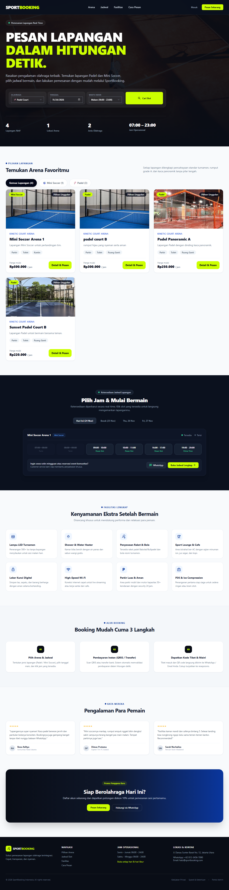
* **Status:** <font color="#16a34a">**PASS**</font>
* **Keterangan Gambar:** Menampilkan halaman depan SportBooking dengan navbar navigasi lengkap (Arena, Jadwal, Fasilitas, Cara Pesan), hero banner promosi, dan tombol call-to-action 'Pesan Sekarang'. Desain modern dan responsif ter-render tanpa kendala styling.

---

### TC-01-02: Katalog Cabang Olahraga & Arena (`/arena`)
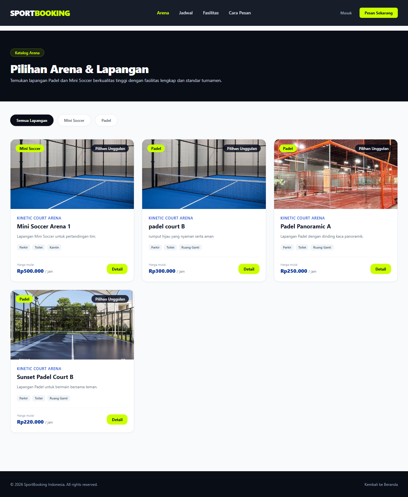
* **Status:** <font color="#16a34a">**PASS**</font>
* **Keterangan Gambar:** Menampilkan katalog arena olahraga aktual (Padel dan Mini Soccer). Setiap kartu arena memuat foto fasilitas yang sesuai (bukan foto acak), keterangan fasilitas rumput sintetis/kaca panoramic, dan tombol menuju pemilihan lapangan.

---

### TC-01-03: Pengecekan Jadwal Lapangan Real-Time (`/jadwal`)
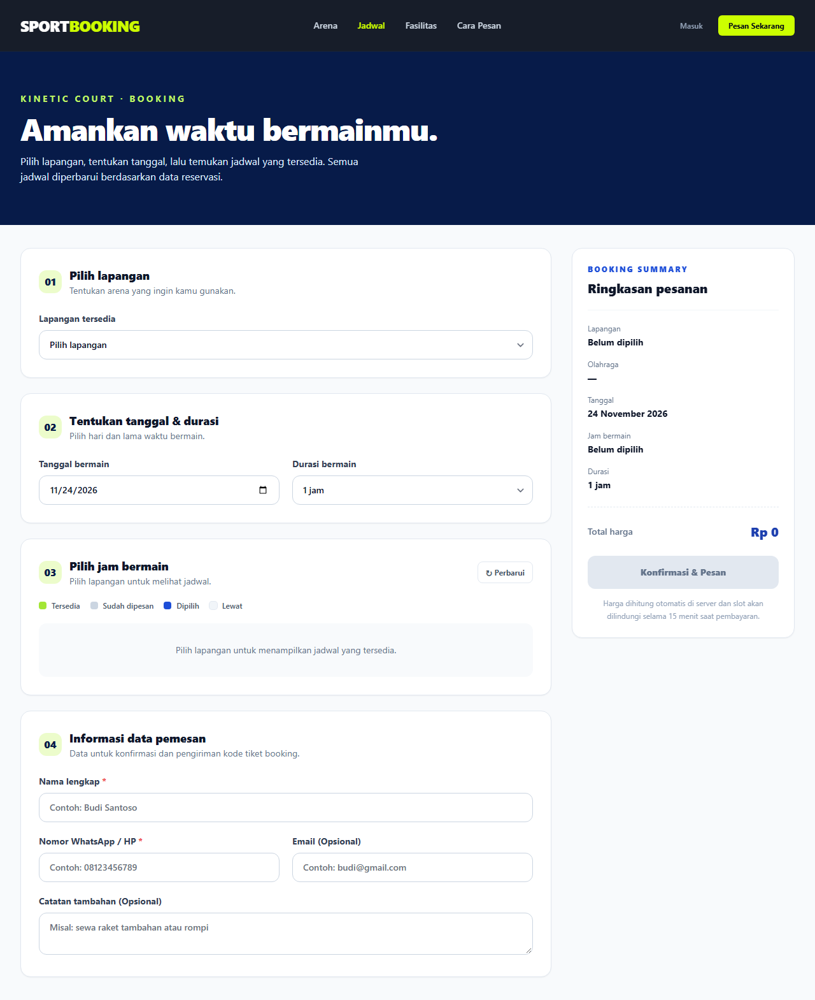
* **Status:** <font color="#16a34a">**PASS**</font>
* **Keterangan Gambar:** Fitur pemilihan tanggal dan pengecekan ketersediaan slot jam main secara real-time. Memungkinkan calon penyewa memeriksa apakah jam operasional tersedia sebelum melanjutkan reservasi.

---

### TC-01-04: Formulir Login Autentikasi Pengguna (`/login`)
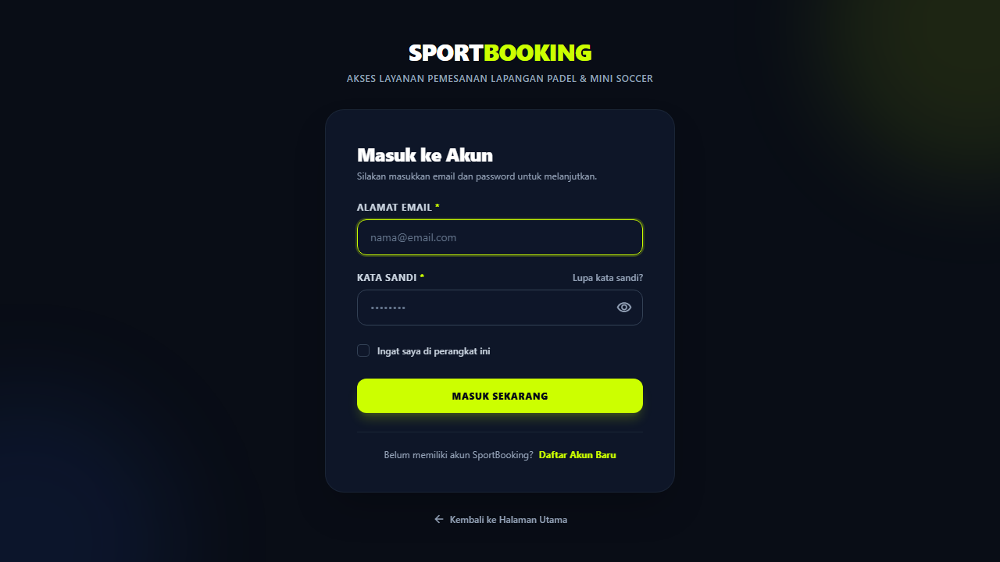
* **Status:** <font color="#16a34a">**PASS**</font>
* **Keterangan Gambar:** Halaman login dengan sistem validasi aman berbasis Laravel Breeze. Dilengkapi perlindungan token CSRF, input field email dan password, opsi Remember Me, serta link lupa password.

---

### TC-02-01: Panel Dashboard Administrator (`/admin/dashboard`)
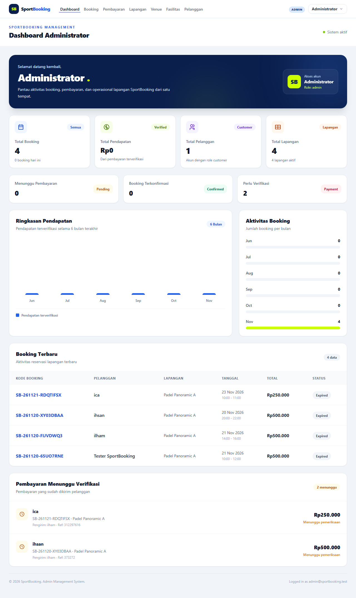
* **Status:** <font color="#16a34a">**PASS**</font>
* **Keterangan Gambar:** Tampilan panel kontrol Administrator setelah login berhasil. Menampilkan ringkasan metrik omset total pendapatan, statistik pesanan masuk, pemesanan yang menunggu verifikasi, dan status ketersediaan lapangan.

---

### TC-03-02: Manajemen Inventaris Lapangan (`/admin/courts`)
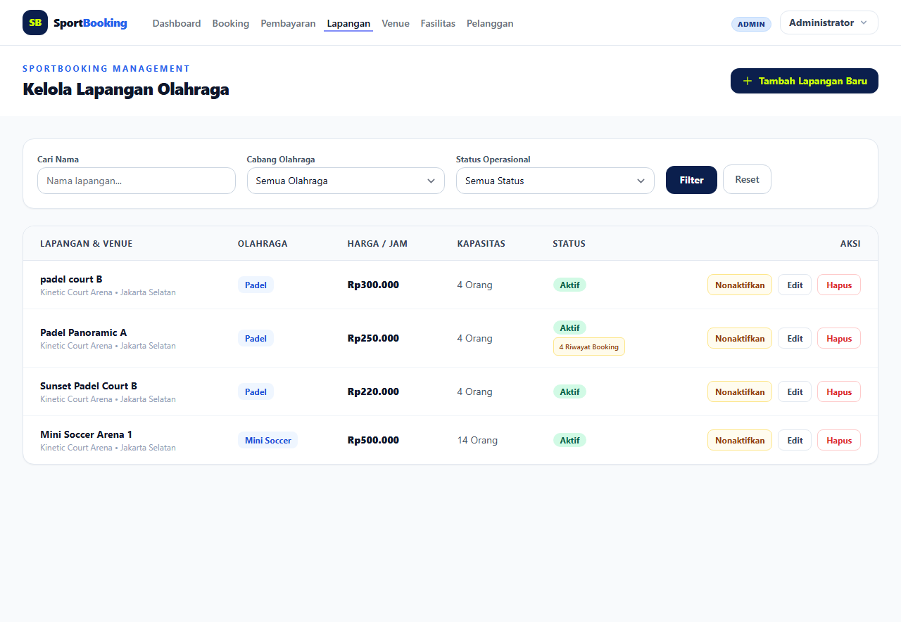
* **Status:** <font color="#16a34a">**PASS**</font>
* **Keterangan Gambar:** Tabel data lapangan olahraga. Admin dapat meninjau tarif harga sewa per jam, kapasitas pemain, status operasional (Aktif/Nonaktif dengan badge hijau/kuning), serta opsi Edit, Hapus, dan Pengaturan Foto Galeri.

---

### TC-03-03: Formulir Registrasi Lapangan Baru (`/admin/courts/create`)
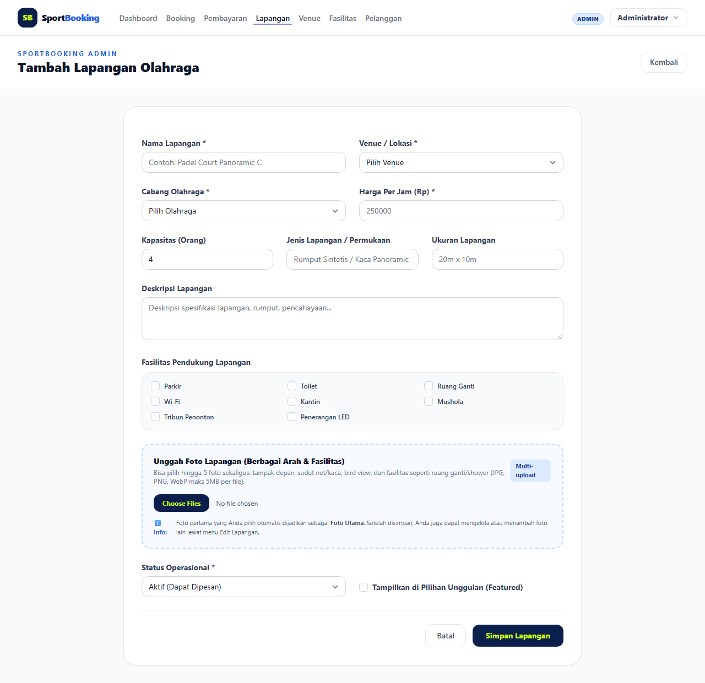
* **Status:** <font color="#16a34a">**PASS**</font>
* **Keterangan Gambar:** Form input penambahan lapangan baru, mencakup dropdown pemilihan venue, asosiasi cabang olahraga, penetapan tarif sewa per jam, pemilihan fasilitas pendukung, serta multi-upload foto galeri.

---

### TC-03-07: Verifikasi Pembayaran Masuk (`/admin/payments`)
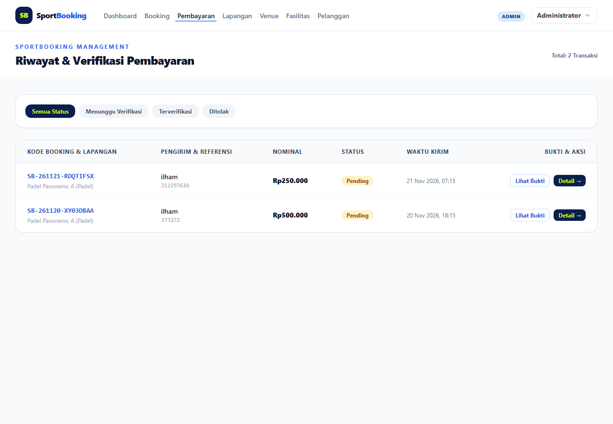
* **Status:** <font color="#16a34a">**PASS**</font>
* **Keterangan Gambar:** Modul verifikasi transfer pembayaran perbankan dari customer. Admin dapat memeriksa bukti transfer foto, menyetujui transaksi (merubah status menjadi Confirmed), atau menolak jika bukti tidak valid disertai alasan penolakan.

---

### TC-04-03: Dashboard Pelanggan & Riwayat Reservasi (`/customer/dashboard`)
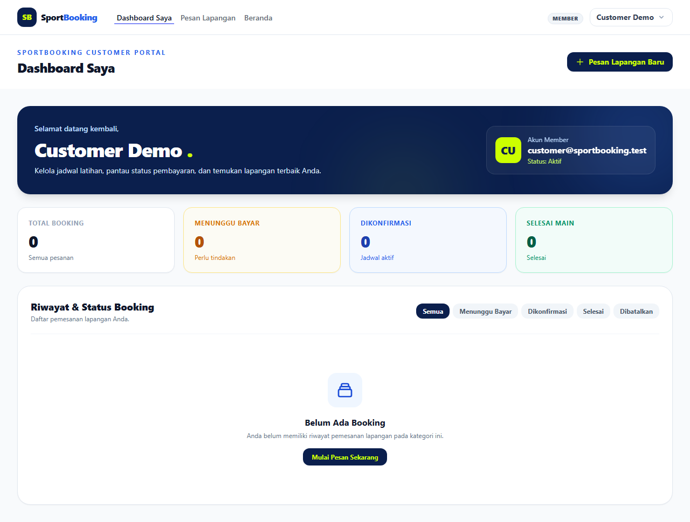
* **Status:** <font color="#16a34a">**PASS**</font>
* **Keterangan Gambar:** Area pribadi pelanggan untuk mengelola pemesanan lapangan miliknya, memantau batas waktu transfer pembayaran, melihat riwayat booking lampau, dan melakukan pembatalan mandiri untuk pesanan pending.

---

### TC-02-04: Proteksi Keamanan Akses Role-Based (RBAC - 403 Forbidden)
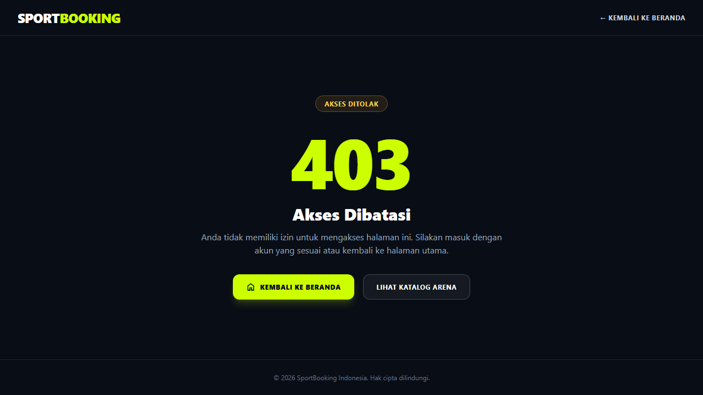
* **Status:** <font color="#16a34a">**PASS**</font>
* **Keterangan Gambar:** Bukti pengujian keamanan akses bertingkat. Saat pengguna dengan hak akses 'Customer' mencoba mengakses URL administrator (`/admin/dashboard` atau `/admin/payments`), sistem secara otomatis memblokir akses dan merender status HTTP 403 Forbidden.

---

### TC-05-01: Penanganan Halaman Error 404 Branded
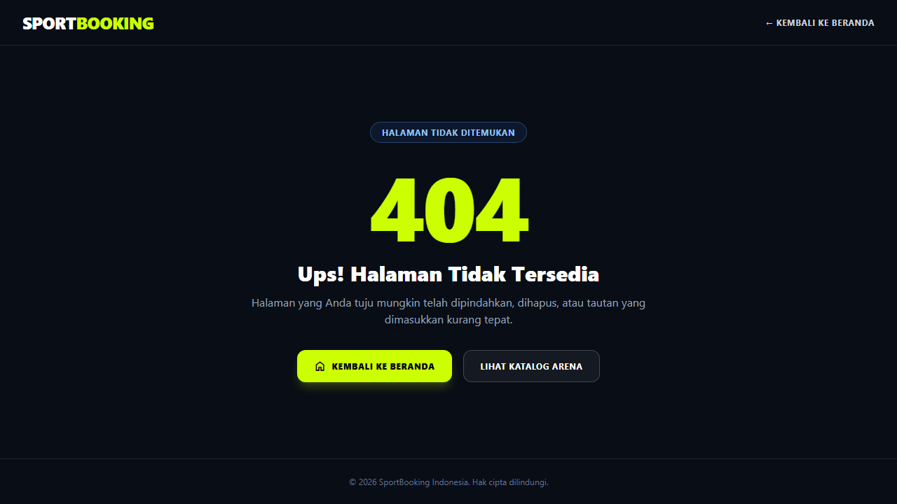
* **Status:** <font color="#16a34a">**PASS**</font>
* **Keterangan Gambar:** Bukti pengujian ketahanan edge case: URL booking fiktif atau rute yang tidak valid ditangani dengan halaman error 404 bermerek SportBooking yang informatif, ramah pengguna, dan dilengkapi navigasi kembali ke beranda.

---

## 3. Cara Menjalankan Ulang Test Suite

Aplikasi pengujian Playwright ini dapat dijalankan kapan saja melalui terminal:

```bash
cd QA/playwright-qa

# 1. Jalankan seluruh pengujian otomatis
npx playwright test

# 2. Buka laporan interaktif HTML
npx playwright show-report

# 3. Jalankan dengan tampilan browser interaktif (Headed Mode)
npx playwright test --headed
```
